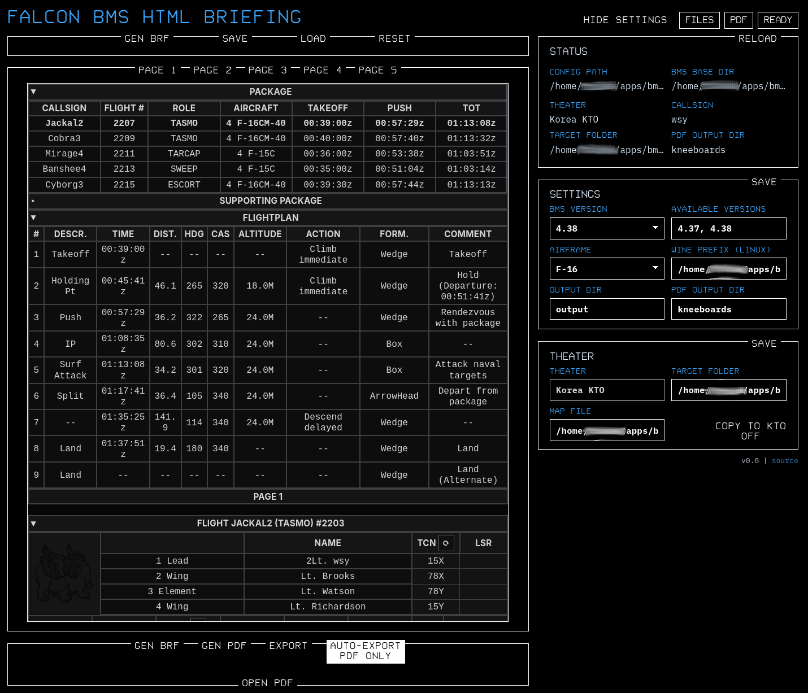
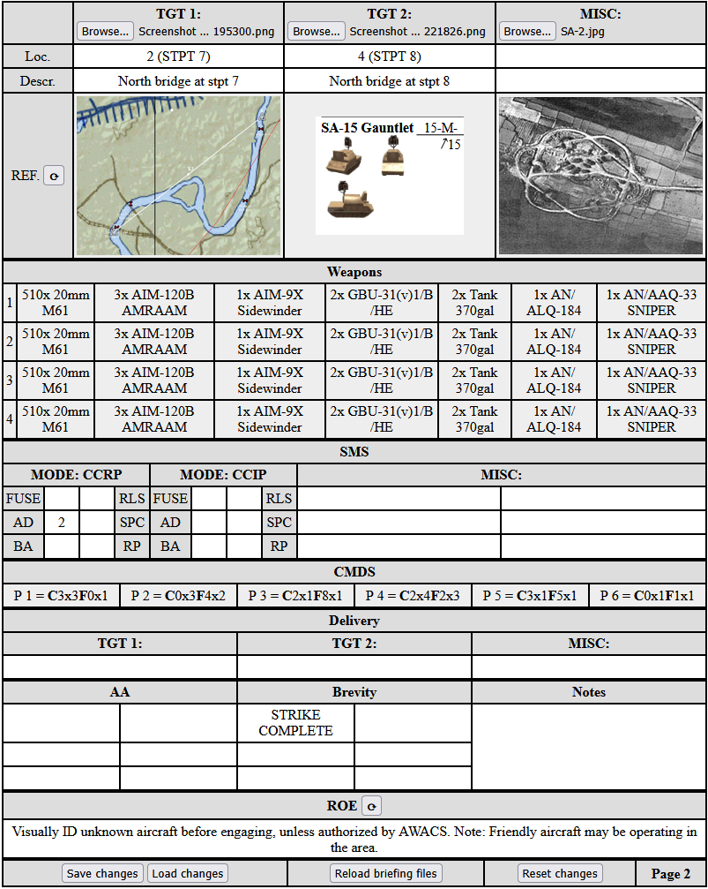
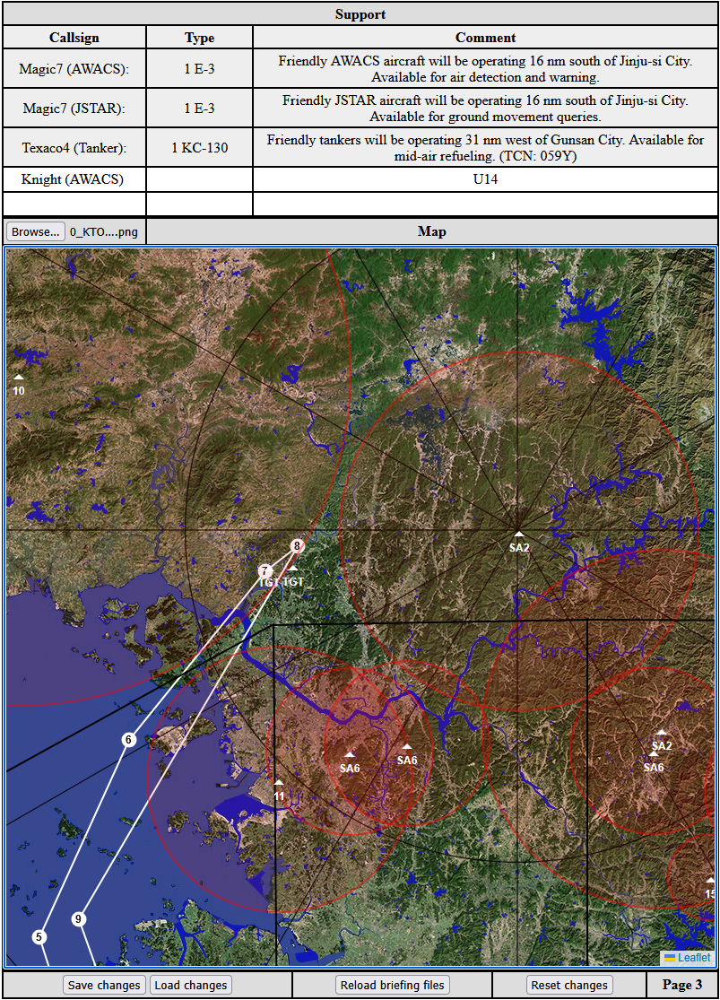

# Falcon BMS HTML Briefings

This is a tool to generate editable kneeboard files for use with Falcon BMS.

HTML Briefing is inspired by other wonderful BMS kneeboard tools, such as [bms-kneeboard-server](https://github.com/AviiNL/bms-kneeboard-server), [EZBoards](https://forum.falcon-bms.com/topic/19901/ezboards-generate-kneeboards-flights-comms-stpts-weather-from-briefings) and [Weapon Delivery Planner](https://www.weapondeliveryplanner.nl/).

The main difference is that I wanted an open source tool that has ~~minimal~~ reasonable dependencies, is cross-platform, and allows quick edits to briefing files after they are filled with briefing.txt data. The default kneeboard setup is informed by my practice during multiplayer flights with [UOAF](https://uoaf.net/).

## Main features and goals

- [x] Works both on Linux and Windows.
- [x] Automatically reads BMS and theater data from the registry.
- [x] Allows to edit kneeboards after they are populated with callsign.ini and briefing.txt data.
- [x] Single-click PDF and BMS kneeboards export.
- [x] Functional map.
- [x] Parse binary save file data.
- [x] Edit DTC defaults.
- [x] Compute the parameters for pop-up attacks and set offset aimpoints.
- [x] Support adding generated airport and approach charts.

## Usage

### Using the provided executable

Make sure that "Briefing output to file" option is `ON` in BMS config, and "HTML Briefings" is `OFF`.

Unpack the archive and launch the html_brief executable. You can then access the application interface in your browser at 127.0.0.1:8000 (the port can be changed via the `-p PORT` launch option).

Linux users need to specify the **absolute** Wine prefix—the folder where the BMS `drive_c` lives—either in config.ini or in the interface (and save it from there).

Click "Show settings" on the top dashboard to open the settings toolbar, where you can verify detected folders and choose the BMS version and airframe you are using.

The "Copy to KTO" checkbox copies the .dds kneeboard to the default KTO folder. This may be needed for some theater/aircraft combinations; see this [forum thread](https://forum.falcon-bms.com/topic/31944/f-15-kneeboard-textures-sourced-from-wrong-folder-in-all-standard-add-on-theaters).

To update the briefing and steerpoints information, you need to do these things in BMS 2D map screen: 0) Click your flight and seat; 1) press "Briefing" -> "Print"; 2) save DTC.

The save file can be loaded from the Settings dialogue.

#### Note on kneeboard export:

All the `.pdf, .png, .jpg` files in the `kneeboards` folder will be exported to BMS kneeboards, so you can add your own kneeboard pages. These can be re-ordered in a menu below the briefing window.

#### Logo

Replace `assets/logo.png` with your own logo (appears in the flight roster section), because why not.

### From source

1. (Optional) Create and activate a Python venv.
2. `pip install -r requirements.txt`
3. `python html_brief.py`

### Configuration

- The app reads and writes `config.ini` next to the executable (or this repository root when run from source). If it does not exist, a default one is created on first launch.
- Settings changed in the UI are saved back to `config.ini` and theatersXXX.ini on "Save config" click.
- Paths can be absolute or relative; relative paths are resolved from the folder where the executable/script lives.
- `briefing_scroll_mode` can be `continuous` or `paged`. `paged` shows one generated briefing page at a time in the interface preview.
- Minimal example:

```
[system]
output_dir = output
pdf_output_dir = kneeboards
wine_prefix =
auto_export_on_change = False
auto_export_pdf_only = False
debug_log = False
map = esri_imagery_hybrid
briefing_scroll_mode = continuous

[bms]
bms_version = 4.38
bms_available_versions = 4.37, 4.38
default_airframe = F-16

[pages]
charts =
page1 = atis, airbase, main_package, supporting_package, weather
page2 = roster, cmds, admin, weapon_settings, custom_checklist
page3 = flightplan
page4 = targets, tgtsteerpoints, wpn_targets, delivery, aa_brevity_notes, roe, support
page5 = map
page6 = comms

[briefing_style]
font_size = 16
spacing = normal

```

#### Configuration override

In case you want to override the auto-detected BMS parameters (for example, if your callsign was read from the registry with some weird characters and the app fails to detect the .ini file), you can add an 'override' section to the config.ini as follows:

```
[override]
callsign = <SET CALLSIGN>
base_dir = <BMS base dir>
theater = <BMS theater>
```

### Map

Starting with version 0.5 there is an option to add a map to the kneeboards. This uses [Leaflet](https://leafletjs.com/).

The map can be dragged with the mouse and zoomed with the mouse wheel. Double-click sets the bullseye. Loading the save file saves bullseye automatically.

The map has two modes: local and web. Web mode uses Esri satellite imagery layer and is available for BMS 4.38 and newer; earlier versions automatically use local tiles because their terrain coordinates differ. Local mode converts a map file specified in the theater .ini file. Coordinate and elevation calculations are based on
[falcon-bms-tacview-converter](https://github.com/oakdesign/falcon-bms-tacview-converter/).

The map images usually come with the theater install. For example (all folders are relative to the Falcon BMS install path):

- KTO has several map images to choose from in `Docs/05 Maps/` folder
- ITO similarly has those in `Data/Add-On Israel/Docs/02 Maps` folder,
- Coastal Front for BMS 4.37 has maps in `Data/Add-On Coastal Front/Docs/Tacview_and_WDP_files/WDP/Coastal Front` folder.

### Reference images

Targets section of the kneeboard can be used to upload target reference images. The images can also be pasted in all editable briefing fields.

### Charts

Starting with the version 1.2, the app can generate ground, parking and "approach" charts from BMS data, building upon oakdesign's [OpenTaxiway](https://github.com/oakdesign/OpenTaxiway/) tool. Ground and parking charts functionally correspond to the automatically generated charts distributed with the official BMS theaters (but can be generated for any theater automatically). The "approach" chart are currently a bit "gamified": they contain only the basic topographic information as well as relevant TCN/ILS info.

The new corresponding `config.ini` option syntax is as follows:

```
[pages]
charts = departure_ground, departure_parking, departure_local, arrival_ground, arrival_parking, arrival_local, alternate_ground, alternate_parking, alternate_local
```

As many other options this can be set in the UI.

Charts need to be generated for each airfield, which may take some time (~5-10 seconds per chart), but each chart is only done once and is saved for later use.


### Launch options

- `-p PORT`: set the port (default: 8000).
- `--no-browser`: prevent the app from automatically opening a browser tab on startup.
- `--tray`: force tray mode when running from source.
- `--no-tray`: disable tray mode for the frozen executable.
- `-c`: specify the config file.
- `-t`: specify the theater config file pattern, the format is `xxx{version}yyy.ini`

## Modification

The templates to generate kneeboards are in the "templates" folder. Most are jinja2 templates written in simple HTML, so should be easy to modify.

## Example output

<p float="left">

</p>

## Chart generator (command line)

The chart generator used by the app can also be run on its own to produce charts for a whole theater, for example to publish a replacement for the charts shipped with BMS. It does not need the web interface. It is available as a standalone executable (`openchart_cli.exe`) or from source (see "From source" above for the setup):

```
openchart_cli.exe [options]
python -m openchart.cli [options]     # from the repository root
```

For every airfield it can write up to three charts:

- **Ground chart** - taxiways, runways and parking.
- **Parking charts** - one page per runway end, with numbered parking spots. Airfields without parking data have none.
- **Local chart** - the topographic chart (50 x 50 NM, 500 ft elevation bands), only with `--topo` or `--bms-layout`.

### Options

| Option             | Description                                                                                                                                                                                                                   |
| ------------------ | ----------------------------------------------------------------------------------------------------------------------------------------------------------------------------------------------------------------------------- |
| `--data-root PATH` | The BMS theater data folder, for example `C:\Falcon BMS 4.38\Data` for Korea or `C:\Falcon BMS 4.38\Data\Add-On Hellas` for an add-on theater. The folder must be `Data` itself or sit directly inside a folder named `Data`. |
| `--output DIR`     | Folder to write the charts to (default: `test_charts`).                                                                                                                                                                       |
| `--airport ID`     | Campaign ID of an airfield; repeat for several. Without it, four Korea airfields are used (995, 1784, 1486, 983).                                                                                                             |
| `--all-airports`   | Generate every airfield in the theater instead of listing IDs.                                                                                                                                                                |
| `--format`         | `svg`, `png`, `pdf`, `both` (svg + pdf) or `all` (svg + png + pdf). Default `svg`. With `--bms-layout`: `png`, `pdf` or `all` (png + pdf).                                                                                    |
| `--topo`           | Also write the local (topographic) chart.                                                                                                                                                                                     |
| `--bms-layout`     | Write the charts in the folder layout described below, one folder per airfield, grouped by team. Includes the local chart.                                                                                                    |
| `--campaign FILE`  | Use the airfields and owners of a campaign file (`.tac`/`.cam`) instead of the theater defaults.                                                                                                                              |
| `--dpi N`          | Resolution of PNG and PDF output (default 150).                                                                                                                                                                               |

### Examples

```
# Every airfield of a theater, PNG and PDF, grouped by team
openchart_cli.exe --data-root "C:\Falcon BMS 4.38\Data\Add-On Hellas" --all-airports --bms-layout --format all --output "Hellas Charts"

# Two airfields as PDF including the local chart
openchart_cli.exe --data-root "C:\Falcon BMS 4.38\Data" --airport 1784 --airport 995 --format pdf --topo --output charts
```

### Finding airfield IDs

The IDs are the campaign IDs of the airfields. From source:

```
python -c "from openchart.source import AirportRepository; r=AirportRepository(r'C:\Falcon BMS 4.38\Data'); [print(e.campaign_id,'|',e.name,'|',e.icao) for e in sorted(r.entries,key=lambda e:e.name)]"
```

### Output layout (`--bms-layout`)

```
<output>/<Team>/<Airfield name (ICAO)>/<Airfield name (ICAO)>_AGC.png|pdf
                                       <Airfield name (ICAO)>_APC_RWY09L.png ...
                                       <Airfield name (ICAO)>_APC.pdf
                                       <Airfield name (ICAO)>_LOC.png|pdf
```

- `_AGC` is the ground chart, `_APC` the parking charts and `_LOC` the local chart. PNG output has one `_APC_RWYxx` image per runway end; the PDF has one `_APC.pdf` with all runway ends as pages.
- The team folder is the airfield's owner at the start of the campaign, read from `Campaign/Te_New_Nt.tac` of the theater (or the file given with `--campaign`). Team names are used as they are stored (for example `ROK`, `Turkey`, `NATO`); rename the folders afterwards if you prefer. Airfields that are not in the file go to `Unassigned`.
- The airfield name drops a trailing "Airport" or "Airbase" and adds the ICAO code when the airfield has one. Folder names ending with a dot lose it (`U.S.` becomes `U.S`) because Windows does not allow it.

### Notes

- The generated pages are A4 portrait at 150 dpi, not the landscape images shipped with BMS.
- Existing files are overwritten, but folders from earlier runs are not removed.
- Each file path is printed as it is written. An airfield whose local chart cannot be created (for example because the theater has no height map) is reported and skipped.
